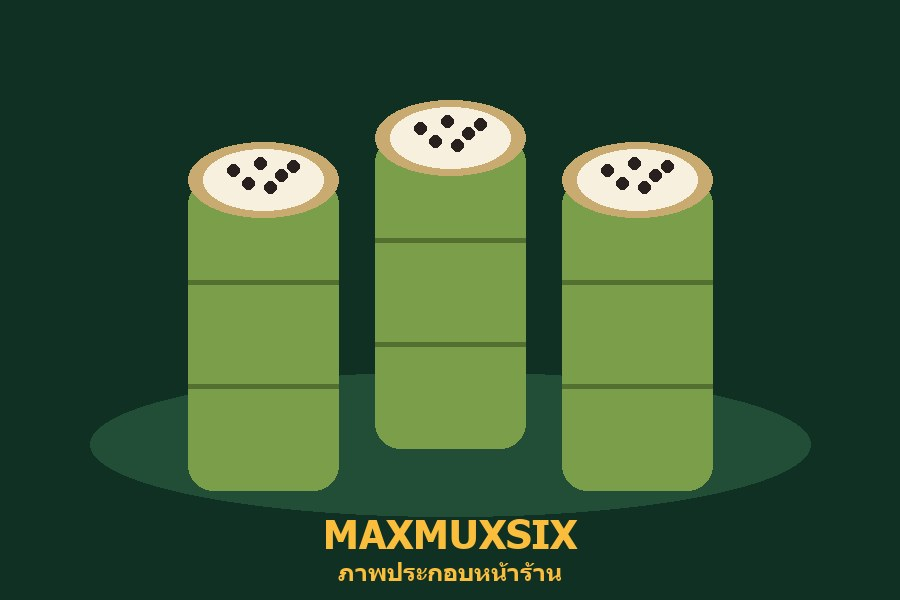

# MAXMUXSIX Online Store

Demo storefront for MAXMUXSIX, a charcoal-grilled sticky rice (ข้าวหลามเตาถ่าน) shop in Nong Mon, Chon Buri. It does not sell, deliver, or take payments.

[ภาษาไทย](README_TH.md) · [User guide](docs/user-guide.md) · [Configuration](docs/configuration.md) · [Development](docs/development.md)



## Requirements

- Node.js 22 or later (tests and builds) and Python 3 (to serve the files)
- Google Chrome, only for the browser test

## Setup

```bash
npm ci --ignore-scripts
python -m http.server 8000
```

Then open http://localhost:8000/ in your browser. Do not open `index.html` from disk: membership email links need HTTP(S).

## Features

- **Shopping:** product search and filters, a cart with coupon codes, and a flavour quiz
- **Membership:** sign-up, email confirmation, sign-in, and password reset through Supabase Auth
- **Email and chat:** order emails and a LINE bot, both run by Google Apps Script

## Usage

| Task | Where |
|---|---|
| Find a product | Search box and filters on the front page |
| Add to cart | "🛒 เพิ่มลงตะกร้า" on a product card |
| Apply a coupon | Coupon box in the cart (`MAX10` needs 150 baht) |
| Sign in | Membership area, "เข้าสู่ระบบ" |

## Configuration

Public settings are in `auth-config.js`; see [docs/configuration.md](docs/configuration.md). Never put a `service_role` or `sb_secret` key in this repo.

## Tests

```bash
npm test
```

## Project layout

- `index.html` (storefront) and `auth-config.js` (public Supabase settings)
- `assets/`, `scripts/`: JavaScript, vendor bundle, images, and build helpers
- `supabase/`, `tests/`: migrations, Edge Functions, and tests
- `docs/`: user guide, configuration, development, and setup notes
- `*_apps_script.js`: Google Apps Script files (install one LINE bot file per project)

## License

`package.json` sets the license to `UNLICENSED`. No open-source license is granted.
