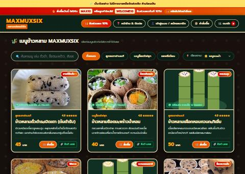
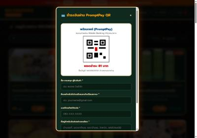
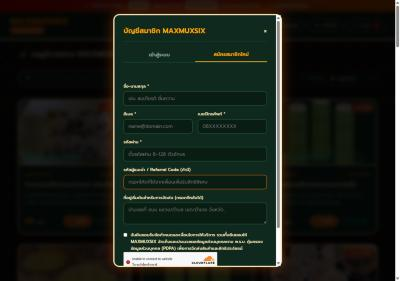

# User guide

This guide is for visitors browsing the MAXMUXSIX demo storefront. Each task follows the same structure: goal, prerequisites, steps, result, and troubleshooting.

**Demo notice:** This site is a sample storefront. It does not sell, deliver, or take payments. The page displays this notice in several places: *"เว็บตัวอย่าง ไม่มีการขายหรือจัดส่งจริง ห้ามโอนเงิน"* (sample site; no real sales or delivery; do not transfer money).

Note: Storefront browsing, cart, and coupons work standalone in the browser. Membership and email features (tasks 4–7) require a configured Supabase project and Google Apps Script relay (see [configuration.md](configuration.md)).

## 1. Browse the menu

**Goal:** Find a sticky rice product on the front page.

**Before you start:** Open the site in a browser (see the README for local server setup).

**Steps:**
1. Scroll to the product section with the heading "เมนูข้าวหลาม MAXMUXSIX".
2. Type in the search box (placeholder `"🔍 ค้นหาเมนู เช่น ถั่วดำ, ช็อตมะพร้าว, สังขยา..."`) to narrow the list.
3. Use the category/filter controls above the list to filter further.

**Result:** The list shows only products matching your search and filters.

**If no items match:** The page shows `"ไม่พบรายการข้าวหลามที่ค้นหา!"`. Clear the search box or reset filters and try again.

## 2. Add items to the cart

**Goal:** Put one or more products into your cart.

**Steps:**
1. On a product card, click `"🛒 เพิ่มลงตะกร้า"` (or `"🛒 เพิ่มลงตะกร้าเลย"` from the flavour quiz).
2. Open the cart using the `"ตะกร้า"` button.
3. Review your items under `"ตะกร้าของคุณ"`.

**Result:** The cart lists each product you added and calculates the subtotal.

**Checkout:** Click `"ไปชำระเงิน →"`. The payment dialog is a demo only—do not transfer money.

## 3. Apply a coupon code

**Goal:** Get a 10% discount with a coupon code.

**Steps:**
1. Open the cart.
2. In the coupon box (placeholder `"พิมพ์ MAX10 เพื่อลด 10%"`), enter a code and apply it.

| Code | Rule | Message on success | Message if not met |
|---|---|---|---|
| `MAX10` | Subtotal of at least 150 baht | `"✅ ใช้โค้ดสำเร็จ! ได้รับส่วนลด 10%"` | `"⚠️ ซื้อขั้นต่ำ 150 บาทเพื่อใช้โค้ดนี้"` |
| `WELCOME10` | No minimum | `"🎉 โค้ดต้อนรับสมาชิกใหม่สำเร็จ! ได้รับส่วนลด 10%"` | Not applicable |

**Result:** The success message appears and the total drops by 10%.

**If it fails:** Read the message under the coupon box; it explains which condition was not met.

## 4. Sign up and confirm your email

**Goal:** Create a member account.

**Before you start:** Requires a configured Supabase project (see [configuration.md](configuration.md)) and an accessible email address.

**Steps:**
1. Open the membership modal (`"บัญชีสมาชิก MAXMUXSIX"`).
2. Select `"สมัครสมาชิกใหม่"`.
3. Enter your email (for example `yourname@email.com`), password, and required details, then complete the Turnstile check if enabled.
4. Open the confirmation email and follow the link.
5. Return to the site and sign in (task 5).

**Result:** Once your email is confirmed, you can sign in.

**If it fails:** If the email format is invalid, the form shows `"กรุณากรอกอีเมลให้ถูกต้อง"`. Correct the email and submit again.

## 5. Sign in

**Goal:** Sign in with a confirmed member account.

**Steps:**
1. Open `"บัญชีสมาชิก MAXMUXSIX"` and select `"เข้าสู่ระบบ"`.
2. Enter your email and password.
3. Submit the form.

**Result:** You are signed in and your member session is active.

**If it fails:** The form shows `"เข้าสู่ระบบไม่สำเร็จ กรุณาตรวจสอบข้อมูลและลองใหม่"`. Verify your email and password and try again. Five failed attempts block sign-in locally for 5 minutes (see [configuration.md](configuration.md)).

## 6. Reset your password

**Goal:** Set a new password if you forget your current one.

**Steps:**
1. Open `"บัญชีสมาชิก MAXMUXSIX"` and click `"ลืมรหัสผ่าน?"`.
2. Enter your email and submit.
3. Open the password reset email and follow the link.
4. Set a new password.

**Result:** You can sign in with the new password.

**If it fails:** The reset link redirects to the URL configured in `redirectUrl` in `auth-config.js` (see [configuration.md](configuration.md)). Make sure `redirectUrl` matches the site origin you are using.

## 7. Get a subscriber discount code

**Goal:** Receive the `WELCOME10` discount code by email without signing up as a member.

**Steps:**
1. Scroll to the section `"สมัครรับข่าวสาร & รับโค้ดส่วนลด 10%"`.
2. Enter your email and submit.

**Result:** The page confirms your subscription request and dispatches the welcome email (when the Apps Script relay is configured).

**If it fails:** The form limits requests to 5 subscribe attempts per hour in the browser.

## Related guides

- [Configuration](configuration.md): settings, rate limits, and defaults
- [Development](development.md): install, test, CSP hashes, and build
