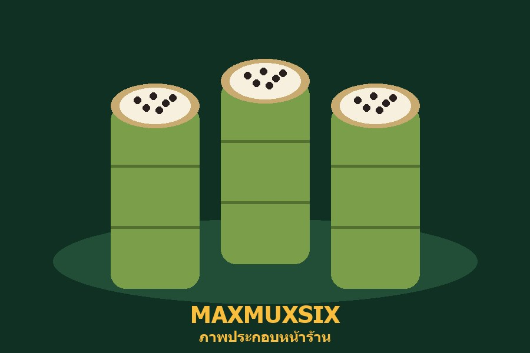

# คู่มือใช้งาน

คู่มือนี้สำหรับผู้ที่เข้าชมเว็บสาธิตของ MAXMUXSIX แต่ละงานมีส่วนเหมือนกัน ได้แก่ เป้าหมาย สิ่งที่ต้องเตรียม ขั้นตอน ผลลัพธ์ และสิ่งที่ควรทำเมื่อไม่สำเร็จ

**ประกาศสำหรับเว็บตัวอย่าง:** เว็บนี้เป็นตัวอย่าง ไม่ขาย ไม่จัดส่ง และไม่รับชำระเงิน หน้าเว็บแสดงข้อความ *"เว็บตัวอย่าง ไม่มีการขายหรือจัดส่งจริง ห้ามโอนเงิน"* หลายจุด

งานที่มีเครื่องหมาย **ยังไม่ได้ตรวจ** ยังไม่เคยรันตลอดทั้งขั้นตอนใน repo นี้ ควรทดสอบก่อนนำไปใช้จริง

## 1. ดูเมนู

**เป้าหมาย:** หาข้าวหลามที่ต้องการจากหน้าแรก

**ก่อนเริ่ม:** เปิดเว็บในเบราว์เซอร์ (ดูวิธีเปิดในไฟล์ README)

**ขั้นตอน:**
1. เลื่อนลงไปยังส่วนที่มีหัวข้อ "เมนูข้าวหลาม MAXMUXSIX"
2. พิมพ์ในช่องค้นหา (ข้อความแนะนำ "🔍 ค้นหาเมนู เช่น ถั่วดำ, ช็อตมะพร้าว, สังขยา...")
3. ใช้ตัวกรองอื่นที่อยู่เหนือรายการ ถ้ามี เพื่อจำกัดสินค้ามากขึ้น

**ผลลัพธ์:** รายการแสดงเฉพาะสินค้าที่ตรงกับการค้นหาและตัวกรอง

**ถ้าไม่สำเร็จ:** หากไม่มีสินค้าตรงเลย หน้าเว็บจะแสดงข้อความ "ไม่พบรายการข้าวหลามที่ค้นหา!" ให้ล้างช่องค้นหาแล้วลองใหม่

## 2. ใส่สินค้าลงตะกร้า

**เป้าหมาย:** เลือกสินค้าหนึ่งรายการขึ้นไปเก็บไว้ในตะกร้า

**ขั้นตอน:**
1. ที่การ์ดสินค้า กดปุ่ม "🛒 เพิ่มลงตะกร้า" หรือ "🛒 เพิ่มลงตะกร้าเลย"
2. เปิดตะกร้าจากปุ่ม "ตะกร้า"
3. ตรวจรายการที่อยู่ใต้หัวข้อ "ตะกร้าของคุณ"

**ผลลัพธ์:** ตะกร้าแสดงสินค้าทุกรายการที่คุณเพิ่ม

**ไปชำระเงิน:** กดปุ่ม "ไปชำระเงิน →" ขั้นตอนนี้เป็นตัวอย่าง ห้ามโอนเงิน (ดูประกาศด้านบน)

*รอภาพหน้าจอ: มุมมองตะกร้า*

## 3. ใช้โค้ดส่วนลด

**เป้าหมาย:** รับส่วนลด 10% ด้วยโค้ด

**ขั้นตอน:**
1. เปิดตะกร้า
2. พิมพ์โค้ดในช่องโค้ดส่วนลด (ข้อความแนะนำ "พิมพ์ MAX10 เพื่อลด 10%") แล้วยืนยัน

| โค้ด | เงื่อนไข | ข้อความเมื่อสำเร็จ | ข้อความเมื่อไม่ตรงเงื่อนไข |
|---|---|---|---|
| `MAX10` | ยอดรวมสินค้าอย่างน้อย 150 บาท | "✅ ใช้โค้ดสำเร็จ! ได้รับส่วนลด 10%" | "⚠️ ซื้อขั้นต่ำ 150 บาทเพื่อใช้โค้ดนี้" |
| `WELCOME10` | ไม่มียอดขั้นต่ำ | "🎉 โค้ดต้อนรับสมาชิกใหม่สำเร็จ! ได้รับส่วนลด 10%" | ไม่มี |

**ผลลัพธ์:** ข้อความสำเร็จปรากฏและยอดรวมลดลง 10%

**ถ้าไม่สำเร็จ:** อ่านข้อความใต้ช่องโค้ดส่วนลด ข้อความจะบอกเงื่อนไขที่ยังไม่ตรง

## 4. สมัครสมาชิกและยืนยันอีเมล *(ยังไม่ได้ตรวจ)*

**เป้าหมาย:** สร้างบัญชีสมาชิก

**ก่อนเริ่ม:** ระบบสมาชิกต้องมีโปรเจกต์ Supabase ที่ตั้งค่าแล้ว (ดู[การตั้งค่า](configuration_TH.md)) และต้องมีอีเมลที่เปิดอ่านได้

**ขั้นตอน:**
1. เปิดส่วน "บัญชีสมาชิก MAXMUXSIX"
2. กด "สมัครสมาชิกใหม่"
3. กรอกอีเมล (เช่น `yourname@email.com`) รหัสผ่าน และข้อมูลส่วนตัว
4. เปิดอีเมลยืนยันแล้วกดลิงก์
5. กลับมาที่เว็บแล้วเข้าสู่ระบบ (งานที่ 5)

**ผลลัพธ์:** เมื่อยืนยันอีเมลแล้ว เข้าสู่ระบบได้

**ถ้าไม่สำเร็จ:** ฟอร์มแสดง "กรุณากรอกอีเมลให้ถูกต้อง" เมื่อรูปแบบอีเมลผิด ให้แก้อีเมลแล้วลองใหม่

*รอภาพหน้าจอ: ฟอร์มสมัครสมาชิก*

## 5. เข้าสู่ระบบ *(ยังไม่ได้ตรวจ)*

**เป้าหมาย:** เข้าสู่ระบบด้วยบัญชีที่ยืนยันแล้ว

**ขั้นตอน:**
1. เปิดส่วนสมาชิกแล้วกด "เข้าสู่ระบบ"
2. กรอกอีเมลและรหัสผ่าน
3. ส่งฟอร์ม

**ผลลัพธ์:** เข้าสู่ระบบสำเร็จ

**ถ้าไม่สำเร็จ:** ฟอร์มแสดง "เข้าสู่ระบบไม่สำเร็จ กรุณาตรวจสอบข้อมูลและลองใหม่" ให้ตรวจอีเมลและรหัสผ่านแล้วลองอีกครั้ง หากผิดพลาดหลายครั้ง ระบบจะบล็อกการเข้าสู่ระบบ 5 นาที (ดู[การตั้งค่า](configuration_TH.md))

## 6. ตั้งรหัสผ่านใหม่ *(ยังไม่ได้ตรวจ)*

**เป้าหมาย:** ตั้งรหัสผ่านใหม่เมื่อลืมรหัสเดิม

**ขั้นตอน:**
1. เปิดส่วนสมาชิกแล้วกด "ลืมรหัสผ่าน?"
2. กรอกอีเมลแล้วส่ง
3. เปิดอีเมลรีเซ็ตแล้วกดลิงก์
4. ตั้งรหัสผ่านใหม่

**ผลลัพธ์:** เข้าสู่ระบบด้วยรหัสใหม่ได้

**ถ้าไม่สำเร็จ:** ลิงก์ในอีเมลจะพากลับไปยังที่อยู่ในฟิลด์ `redirectUrl` ให้ตรวจว่าที่อยู่นี้ตรงกับเว็บที่คุณเปิด ส่วนการส่งอีเมลเองยังไม่ได้ตรวจใน repo นี้

## 7. รับโค้ดส่วนลดทางอีเมล *(ยังไม่ได้ตรวจ)*

**เป้าหมาย:** รับโค้ดส่วนลดทางอีเมล

**ขั้นตอน:**
1. เลื่อนไปยังส่วน "สมัครรับข่าวสาร & รับโค้ดส่วนลด 10%"
2. กรอกอีเมลแล้วส่ง

**ผลลัพธ์:** หน้าเว็บยืนยันว่าส่งคำขอแล้ว ส่วนการส่งอีเมลโค้ดยังไม่ได้ตรวจ

**ถ้าไม่สำเร็จ:** ระบบจำกัดการส่ง 5 ครั้งต่อชั่วโมง

*รอภาพหน้าจอ: ส่วนสมัครรับข่าวสาร*

## คู่มือที่เกี่ยวข้อง

- [การตั้งค่า](configuration_TH.md): ค่าที่ตั้งได้และค่าเริ่มต้น
- [การพัฒนา](development_TH.md): การติดตั้ง ทดสอบ และ build
